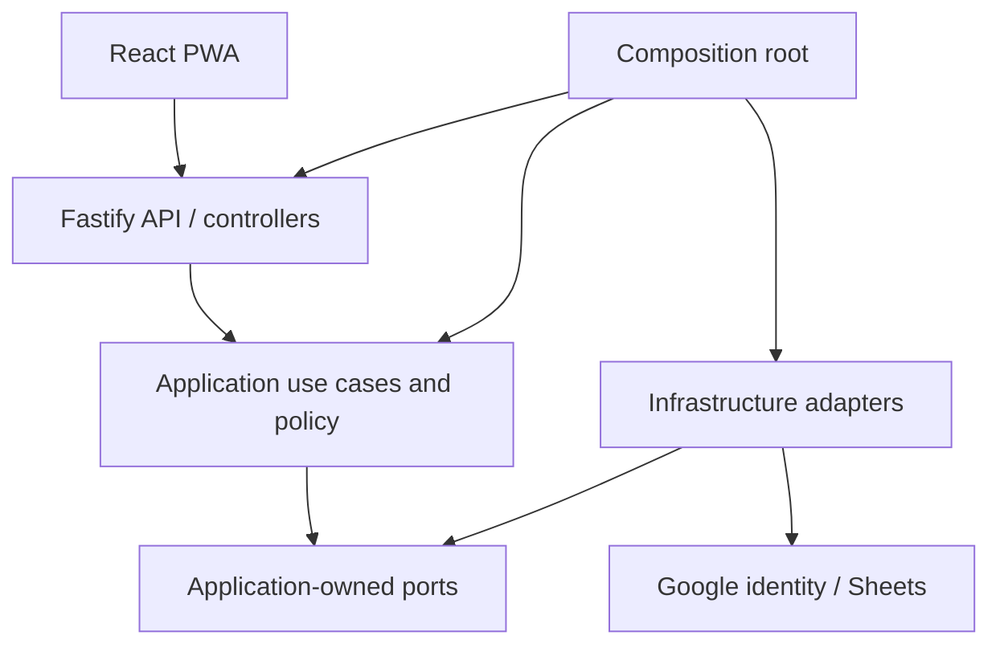

# ExpencesRecord architecture

## Purpose and scope
Private single-user, mobile-first iPhone PWA. Record date, amount, category and currency into an existing annual Google spreadsheet. Repeated entries add to an existing day/category expression. Conversion and totals remain in Sheets; preferences for categories/currencies stay on mobile. The foundation is verified. The active auth feature locally implements the React sign-in shell, Google identity verification, application-owned single-user/session policy, protected Fastify routes and separate read-only Sheets operator setup. Real owner/grant/refresh and the authorized blank-workbook ID-only probe have passed; hosted Preview verification remains pending; no expense endpoints or writes exist.

## Boundaries and dependencies

Arrows within the backend show source dependencies. At runtime, application use cases call infrastructure through application-owned ports. Infrastructure imports those ports; application never imports infrastructure.

| Layer | Owns | Must not own |
|---|---|---|
| Frontend | Form interaction, local preferences, API client, PWA presentation | Authoritative authorization, FX or sheet writes |
| API / controllers | HTTP validation, verified identity handoff, use-case invocation, status/error mapping | Expense, authorization or workbook policy |
| Application | RegisterExpense, allowed-user authorization, date/year/month routing, category/currency rules, accumulation, formula-preserving write planning and permitted-cell policy | HTTP, SDKs, environment access, network or filesystem I/O |
| Infrastructure | Identity signature/claims verification, credentials, Google SDK/I/O, external error translation, execution of approved write plans | Who may use the app, which expense to accept, which cell/formula to choose |
| Composition root | Validate configuration, construct adapters/use cases, inject ports, register transport | Expense policy |
| Shared API contracts | Small wire DTOs and error shapes | Business logic, backend internals, SDK types |

The application receives validated configuration through constructors and owns policy interpretation. Configuration and credentials are loaded outside it. Controllers may validate request shape; application rules still validate the command independently of transport. No DI container or separate domain layer is required without a demonstrated need and approval.

## Expense flow
1. Frontend submits the selected date, amount, category and currency through the app API.
2. Google identity is verified by an adapter; application policy restricts access to the configured user's stable subject. HTTP entry checks and application authorization both apply.
3. Application resolves the configured annual workbook/month layout and allowed input cell via ports; it reads the current expression and necessary structural metadata.
4. Application validates supported expression/currency mappings and plans an additive update, preserving existing terms and correct currency-rate references. Infrastructure sends exactly that permitted write plan.
5. Google Sheets calculates conversion and totals. The app reports a truthful outcome; ambiguous writes are not blindly retried.

The registration flow is conceptual, not an implemented endpoint contract. No endpoint paths have been chosen.

## Spreadsheet boundaries
- Preserve the existing structure, formats, category labels and calculated totals; do not add a transaction tab or database.
- Amount cells can contain formulas. For example, adding another amount to `=(10+20+30)*F39` must retain its existing terms and mapped rate reference. This is a structural example, not a universal formula grammar or confirmed mapping for every workbook.
- F39 is a rate location in the observed example; do not hardcode it for every currency/month/year. Mixed-currency accumulation needs an explicitly tested expression policy.
- Resolve workbook by year and layout by configuration/verified metadata. The user creates the 2027 workbook. Missing mappings and unknown formulas must fail safely before a write.
- Atomic Sheets batches do not isolate read-modify-write operations. In-memory locks do not coordinate serverless instances. Concurrent writes, duplicate submission, ambiguous responses and retry policy must be resolved before production writes; no exactly-once guarantee is currently established.

## Authentication and deployment
Google login and single-user backend authorization are required. The mechanisms are Accepted in [ADR 003](../../adr/003-google-authentication-and-access.md): backend code flow with PKCE/state/nonce, separate encrypted flow/session cookies, fixed seven-day sessions and same-origin CSRF-protected mutations. Only GET/HEAD health and exact GET login/callback are public. A separate local operator flow explicitly confirms the owner and obtains delegated read-only Sheets refresh credentials in existing secure configuration; no federation, service account or new database is used. Actual resources/grants must be verified and recorded before claiming remote completion.

Vercel is selected. Keep Fastify app construction separate from its hosting adapter and configuration, and keep Google SDKs behind application ports. That permits another Node host without moving business policy. The approved foundation packaging uses static output apps/web/dist plus thin root api/index.ts with /api rewrites in one Vercel project. GitHub Actions owns checked preview delivery; automatic Git deployments are disabled. GitHub CI, checked Preview delivery and protected health verification pass on the free Vercel project with Node 24; evidence is recorded in the checklist. A single explicitly approved foundation initialization targeted Production with domain assignment skipped because Vercel requires it for new projects. Ordinary delivery remains Preview only. Production rollout is feature 7.

## Verification and next decisions
Application unit tests use fake ports; API tests exercise real HTTP mapping with Fastify injection; adapters get contract/integration checks; frontend behavior gets interaction tests; dependency-cruiser now provides automated source import checks. All behavior starts with observed failing tests. Vitest/Testing Library and dependency-cruiser are installed; npm run check runs types, lint, tests, boundary checks and builds. Application and infrastructure now contain the locally tested authentication policy and selected Google/crypto/credential adapters. Operator setup is a separate loopback entrypoint; the deployed app never registers its enrollment/consent helper.

Implement tooling, auth, supported formula policy and concurrency controls only through approved feature plans. See [ADRs](../../adr/readme.md) and [bootstrap decisions](../../ongoing-tasks/_bootstrap/decisions.md).

## Implemented foundation map
`apps/web/src` contains the auth shell and central API client. `apps/api/src/api` contains health/auth HTTP mapping and a separately constructed operator callback server; `bootstrap` constructs Fastify and validates local configuration; `server.ts` is local startup. Root `api/index.ts` only adapts Node request/response to that Fastify instance. No application policy or Google adapter is invented for health. Tests live outside src and are exercised from a clean checkout; deliberate forbidden-import fixtures are not production modules. Public methods are limited to GET/HEAD health and exact GET login/callback. Session/logout and newly registered routes use default authentication plus application authorization; mutations require the bound CSRF value and exact Origin. The separate setup-google entrypoint binds to 127.0.0.1:5173 and stores credentials only after local operator confirmation. It is not reachable through api/index.ts. Business endpoints remain absent.
