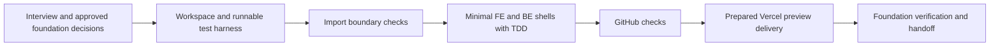
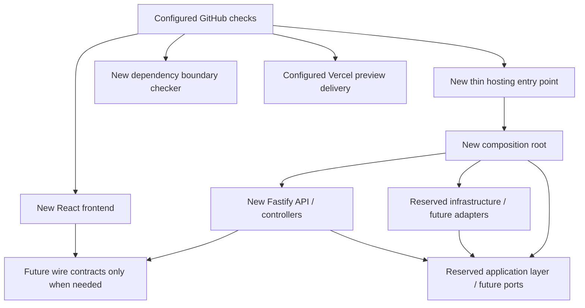

# Application foundation and delivery — Architecture Overview

## 1. Pipeline / Integration

This feature establishes the build/test/delivery foundation for the approved React/TypeScript frontend and Node.js/TypeScript/Fastify backend on Vercel. It does not implement login or expenses. The minimal shells, test harness, boundary checks and host/configuration wiring now exist locally. GitHub/Vercel execution is configured but awaits account access; no Google integration exists.

| Stage | What happens | Where |
|---|---|---|
| Decisions | Complete missing interview; confirm tools, paths, baseline and delivery packaging | Step 01; decision records |
| Workspace and tests | Configure selected tools; make checks runnable before behavior | Step 02; future workspace |
| Boundaries | Enforce inward source dependencies and prevent FE imports of backend internals | Step 03; future automated checks |
| Minimal shells | Test first, then build the minimum frontend and portable Fastify shell | Step 04; future application source |
| Delivery | Run checks before building/deploying a preview; one deployment owner | Step 05; future GitHub/Vercel configuration |
| Handoff | Verify clean-checkout instructions and evidence; update actual project state | Step 06; checks and documentation |

## 2. Component Diagram

Arrows within application code indicate source dependencies. Application must not import Fastify, Google/Vercel SDKs, infrastructure, controllers or environment-loading code. The user approved the code/test tree: apps/web, apps/api/src/{api,application,infrastructure,bootstrap}, external test folders and thin root api/index.ts. Application/infrastructure are empty reserved directories; shared contracts are not created. Configured GitHub/Vercel boxes do not mean remote execution has passed. Do not create speculative use cases, interfaces, Google adapters or DTOs to populate empty layers. Google integrations belong to later features.

## 3. Data Flow

### 3.1 Inbound / Ingestion
Development changes enter GitHub checks. No expense data, Google credentials or spreadsheet data enters this foundation. The minimal UI serves only a foundation shell; no expense entry or login is implemented.

### 3.2 Processing / Event Handling
The selected toolchain runs type/lint/test/boundary checks and builds. A failing required check prevents preview delivery. Test fixtures exercise permitted and forbidden imports. Minimal UI/API behavior is implemented only after meaningful RED has been observed.

### 3.3 Query / Serving
React serves the minimum shell; Fastify construction is separate from server startup/host adaptation. Only a minimal health endpoint may be anonymous if its path/response are confirmed in step 01. No business endpoints are introduced. Preview deployment, if executed during later implementation, serves no private data and uses no production Google configuration.

## 4. Data Stores Summary

| Store | Technology | Collections / Tables / Indices | Purpose |
|---|---|---|---|
| Repository | Existing Git working tree | Planning documents now; source/config only during later implementation | Versioned project foundation |
| CI/build output | Toolchain selected in step 01 | Ephemeral test/build artifacts | Verification and deployment preparation |
| Application database / Sheets | None accessed or created in this feature | None | Expense storage remains a later feature |

No server preference store, token store, cache or coordination database is introduced.

## 5. Extension Points

Later features add Google identity and Sheets adapters through application-owned ports when those use cases are approved. Controllers delegate; application policy stays independent of host/SDK mechanics. Frontend business interactions use a central API boundary once contracts exist. Keep Fastify construction independent of Vercel so another Node host can replace the thin hosting entry point. Test and CI commands established here become required checks for later features.

## 6. Security & Isolation

- All business endpoints require authentication at the API boundary and authorization in application use cases. No business endpoints or permissive authentication bypasses are added in this foundation.
- Minimal health is the existing anonymous exception. Google login initiation/callback public exceptions must be explicitly defined and approved in feature 2; do not infer a blanket public-route exemption.
- No private data, workbook identifiers, Google credentials or production secrets in fixtures, client bundles, repository or preview configuration. Do not loosen `.claude` permissions.
- Composition validates configuration and injects values; application has no environment or I/O access. Controllers/infrastructure contain no business policy.
- Preview and production contexts remain separate. Production rollout and full Google/session/CSRF verification belong to later features. The user subsequently authorized implementation, verified merge and push. This feature permits only checked preview preparation/delivery; production rollout remains feature 7. Account/terms/credential confirmations are completed by the user.
