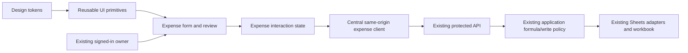

# Daily expense entry and reusable design system — Architecture Overview

## 1. Pipeline / Integration
Execution of roadmap feature 5 was requested on 2026-11-27 after the agreed seven-step scaffold. Step 01 is complete: the user accepted the interaction flow and selected the Apple-inspired direction with the existing teal accent on 2026-11-27. Steps 01-06 are implemented and locally verified with recorded failing-first tests. Step 07 local/browser/security/delivery preparation is active; controlled Google fixtures, private Preview mapping update and checked publication await concrete approval. The user explicitly added a one-category/date/currency amount stack that preserves individual terms in one Sheets write; step 03 is clarified accordingly without adding or reordering steps. Existing Accepted ADRs and the completed backend contracts remain authoritative.



| Step | Agreed responsibility | Initial status |
|---|---|---|
| 01 | Interview, interaction/default decisions, mockup and visual/layout approval | Complete; Apple-inspired design selected by user |
| 02 | Reusable tokens/primitives, state gallery and usage/accessibility guidance | Complete; 8 new interaction tests and full 602-test check passed |
| 03 | Backward-compatible same-cell stack command and typed context/preview/save/comment transport | Complete; contract/client TDD and full 664-test check passed |
| 04 | Mobile form, Options navigation/theme setting, configured catalog, current/past date and optional comment | Complete; entry/appearance/access tests and full 680-test check passed |
| 05 | Selected-cell review, warnings, explicit acknowledgments and stale review handling | Complete; review/conflict TDD and required checks passed |
| 06 | One in-flight save, truthful outcomes, draft/reset behavior and comment-only recovery | Complete; 15 mutation interaction tests and full 703-test check passed |
| 07 | Accessibility/mobile checks, controlled real-owner UI flow and checked Preview handoff | Active locally; controlled setup/publication approval pending |

## 2. Component Diagram
| Component | Existing / proposed | Responsibility |
|---|---|---|
| App/auth shell and auth client | Existing | Session gating, sign-in/logout and in-memory CSRF |
| Options view and local appearance setting | New, proposed | Gear/Back navigation, explicit light/dark choice and bounded device-local theme setting only |
| Tokens and generic React primitives | New, proposed within web app | Reusable visual/interaction contracts; no API, auth or expense policy |
| Synthetic component gallery and usage docs | New | Review supported component states and composition; development-only by default |
| Expense components and interaction orchestration | New | Draft, catalog loading, preview validity, confirmations, saving/result state |
| Typed expense client and wire types | New | Same-origin HTTP, bounded/narrowed responses and safe transport outcomes |
| Fastify controllers/application/ports/adapters | Existing | Protected transport, authoritative authorization/mapping/formula/write policy and Google I/O |
| Annual Sheets workbooks | Existing external service | Authoritative formulas, conversion, totals and anchored comments |

Implemented code/test placement:

```text
apps/web/src/ui/                       tokens and generic primitives
apps/web/src/features/expenses/        expense components and interaction state
apps/web/src/features/options/         Options view and appearance-setting adapter
apps/web/src/api/expenses.ts           expense HTTP client and browser wire types
apps/web/src/app/App.tsx               existing auth shell and composition
apps/web/test/ui/                      reusable interaction/component tests
apps/web/test/features/expenses/       draft/review/save interaction tests
apps/web/test/features/options/        theme persistence/navigation tests
apps/web/test/api/                     existing auth and new expense transport tests
```

Dependencies flow from app/expense components toward shared UI and the API client. Shared UI imports neither expense features nor transport; transport imports neither UI nor backend internals. No new package, router, query/state/form library, UI kit, gallery framework, shared-contract package or storage beyond the reviewed local theme enum is selected implicitly. The explicitly selected stack behavior requires a narrowly reviewed command extension in step 03; it does not alter existing authorization, workbook selection, FX or concurrency boundaries. Use the installed React/CSS/test stack unless a demonstrated need is explicitly approved. Exact component/file contracts and any import-rule extension belong to the reviewed design, not an inferred new architecture.

## 3. Data Flow
### 3.1 Inbound / Ingestion
The authenticated owner supplies one local-calendar date, configured category/currency, an ordered stack of positive decimal amounts and one optional comment for that stack. GET /api/expense-context?date=YYYY-MM-DD supplies the matching catalog; absent years/months fail visibly. Configured past dates are supported; the owner creates/configures future annual workbooks separately. Preferred choices, persisted drafts and offline submission are not inputs introduced by this feature.

### 3.2 Processing / Event Handling
1. Check the existing session before exposing private entry. Keep draft and CSRF only in memory; never log financial content.
2. Resolve the date-specific catalog; ignore responses/selections that no longer match the current draft/date. Client input hints improve usability while backend validation remains authoritative.
3. Preview every exact draft via POST /api/expenses/preview. A fresh single-amount Submit can proceed directly to one save only if currentCell.hasData is explicitly false, canSave is true and warnings is empty. Zero or an empty-looking formula result is not a blank cell. Missing/invalid/failed preview never permits a write.
4. Stacks, existing cells and any warnings open a review view with selected-cell state, total/storage currency, formula disclosure and an arrow Back to edit. Confirm explicitly acknowledges all displayed returned warnings by mapping their flags; no acknowledgment checkboxes. Relevant input/catalog/session/navigation changes invalidate preview/version/acknowledgments; ignore stale replies. A cell_changed response or earlier uncertain attempt requires fresh explicit review, never a silent continuation.
5. Dispatch one POST /api/expenses with the reviewed ordered amount stack, command/version/flags and memory CSRF. Disable duplicate click/Enter submissions while in flight. A backend cell_changed response requires fresh review.
6. Show separate expense/comment results. Known success uses the agreed reset/retention rules; rejected or uncertain outcomes preserve the draft as agreed. Network loss or an unconfirmed reply never becomes a safe automatic retry.
7. A deliberate comment-only recovery uses a fresh preview and POST /api/expenses/comments, never another expense save. Unknown comment outcomes require inspection/review; this is a new request, not durable idempotent recovery.

The backend alone preserves manually edited expressions, constructs complete new FX terms, selects permitted cells and compares fresh snapshots. FE neither evaluates/rewrites formulas nor computes authoritative currency conversion. ADR 007's final-read/commit race and lack of durable request history remain explicit; in-flight UI disabling is not a distributed lock.

### 3.3 Query / Serving
Protected routes and response/status contracts remain the implemented ones in [the backend guide](../../docs/expense-registration.md). The central client interprets HTTP/response shape; expense orchestration owns interaction transitions; generic components render props/events. Plain strings are rendered as text, not HTML. The gallery uses synthetic examples and introduces no additional public route. No financial history, reporting screen or editable formula surface is added; the selected category/month gets the specifically requested read-only aggregate below.

## 4. Data Stores Summary
| Store | Technology | Data | Purpose |
|---|---|---|---|
| View state | In-memory React state | Draft, catalog, preview/version, acknowledgments and result | Current interaction only; no persistence or automatic replay |
| Appearance preference | localStorage single validated light/dark enum | Device-local theme only; no financial/session data or server sync |
| Browser session | Existing HttpOnly encrypted cookie | Existing owner session; CSRF remains in memory | Existing authentication, unchanged |
| Google Sheets | Existing backend-only annual workbook access | Existing formulas, values, conversion, totals and comments | Authoritative records; unchanged structure |

The sole browser-persistence exception is the user-requested appearance choice: one validated light/dark enum in localStorage through a small frontend setting adapter. Reads/writes handle blocked storage with an in-memory fallback and honest unsaved-setting feedback. No expense/category/currency/draft preference, IndexedDB store, database, metadata, receipt ledger, queue or server synchronization is added. Category/currency mobile preferences remain feature 6; PWA install/update/offline/release decisions are feature 7.

## 5. Extension Points
Semantic tokens and documented generic primitives support later screens without importing expense policy. Domain-specific form/review/result components compose those primitives. The gallery documents actual states with synthetic examples and tests interactions; it is not a speculative component catalog. Future mobile preference selection can integrate through the agreed form/catalog boundary in its own feature. Future capabilities use the central client without moving business policy into presentation. The design does not create a shared package, public gallery, new library or new endpoint. Step 03 extends the existing command for same-cell stacks and the protected context read for the requested monthly category total, preserving existing scalar and unconfigured-summary behavior.

## 6. Security & Isolation
- Retain the existing owner guard, same-origin HttpOnly session, exact Origin and CSRF; no new public endpoint or bearer-token convention.
- Browser receives no Google credential, private mapping/workbook/cell address or backend SDK. Keep frontend imports separate from apps/api and root api.
- Treat amounts, comments, formulas, labels and provider results as untrusted display/input data. Render text safely; bound/narrow API results, avoid financial logging/telemetry, and never persist financial/session data in browser storage.
- No client-side authoritative validation, FX, expression construction, cell selection, direct Sheets access, syntax repair or weakened backend guard.
- Never automatically resend a save/comment after uncertainty or re-login. Review state is draft-bound, not a durable receipt. Missing mapping, revoked access and expired sessions remain clear user states.
- Real workbook is never a write-test target. New fixture mutations, private settings, branch-guard/alias transition, publication, main merge and Production need concrete authorization appropriate to those actions. Reuse earlier authorization only within its exact scope.
- Every behavior begins with observed semantic RED, minimal implementation, GREEN/refactor and affected reruns, recorded in the checklist. Pure scaffold/design prose uses content/link/mirror/privacy checks; visual-only styles use visual/accessibility checks. A mockup or passing final suite does not prove TDD order.

## 7. Step-01 concrete design — Apple-inspired direction accepted

### Interview choices accepted
- Order: category, amount, currency, queued amounts, optional comment, Submit. Date defaults to the device's local-calendar today and can select configured past dates.
- A stack has one category, date and currency. Category/date/currency apply to the entire stack; changing them discards prior preview/acknowledgments and does not convert numbers already typed.
- Keep the last-used currency and selected date/category during the open-page session. On the first entry, selections without a known last-used value are explicit; no persistent category/currency preference or expense draft storage is introduced; appearance-only persistence is proposed below.
- After confirmed save, clear the queue, pending amount input and comment; keep selections. Failed/unknown comments are retained as separate in-memory recovery contexts for deliberate comment-only actions, never another amount save. Later expenses do not silently discard earlier pending comments; these contexts are neither persisted nor replayed.
- Keep the clean teal direction and light/dark foundations. The revised mockup uses synthetic Supermarket 5/10/12 AED values and backend-supplied example formula/rate references, not real financial data.

### Proposed interaction details
- Add amount or Enter queues the current valid value and clears the amount input; each queued row has an accessible Remove action. Display an exact decimal subtotal in the selected input currency, without FX calculation or submission of a computed conversion.
- Submit includes any valid unfinished amount input once, then requests the preview for the whole reviewed stack. Invalid pending input blocks submission instead of being silently discarded.
- Revised by user on 2026-11-27: Submit first obtains a backend preview. For one amount and an explicitly empty, writable cell with no warnings, it performs one save without a confirmation screen. For a stack, existing data or any warnings, it opens a review view. Show a header arrow Back to return to editing with the draft intact; Back discards the review/version/acknowledgments. Confirm performs the single mutation and explicitly acknowledges all visible returned warnings; no checkbox. A blocked preview never offers Confirm. Conflict or previously uncertain outcomes always require deliberate fresh review.
- Accept decimal dot or a single decimal comma as input, normalize to the existing dot-only wire decimals, reject grouping/mixed separators, and never round. Each entry keeps the existing nine-integer/six-fractional-digit bounds. Existing Sheets totals/formulas remain backend-owned display values.
- Failure/uncertainty retains the unsaved queue as agreed; no automatic mutation retry. Known expense success clears the numeric draft even if a comment needs separate recovery. A fresh read is not proof of historical identity.

### Comment review and date distinction (user revision, 2026-11-27)
- Review includes a clearly labeled Your comment section whenever the submitted draft has a nonempty optional comment. Render the full text safely with meaningful line breaks and wrapping; do not silently truncate it or replace it with a generic comment-present indicator. Omit the section when no comment is supplied. Back preserves the comment for editing; changing it invalidates the prior preview/version just like other draft changes.
- Display the selected date and weekday (for example Fri, 27 Nov 2026) on both entry and review. Today uses the teal date treatment and explicit Today label plus full date. Earlier dates use a contrasting amber treatment, explicit Past date label and full date. These states must remain distinguishable without color in both selected themes.
- Compare calendar dates in the device local timezone, rather than slicing a UTC timestamp. Reassess the label when returning to the app and before Submit so an open draft crossing midnight is not mislabeled. Derive the weekday from the selected calendar date without UTC/local shifts. Keep the selected date unchanged; existing configured-date validation remains authoritative.
- A Past date appearance is a visual distinction, not an additional backend warning or mandatory confirmation: the approved single-empty-warning-free shortcut still applies to a valid past date. No future-date behavior or new date restriction is introduced.
- Steps 04-05 cover failing-first date/comment interaction tests; step 07 verifies long/multiline and malicious-looking comments, omitted comments, midnight/local-calendar cases and accessible light/dark date treatments.

### Backward-compatible stack contract
The user-approved separate-term stack is implemented locally with this backward-compatible contract:

```json
{"date":"2026-11-27","categoryId":"groceries","currency":"AED","amounts":["5","10","12"],"comment":"Optional text"}
```

- Keep all existing endpoints and legacy amount-string requests. Accept exactly one of amount or amounts, rejecting both/missing/empty/invalid lists. Batch bound is 1-20 amounts per Submit; each amount uses the existing positive decimal normalization and limits.
- Normalize scalar/list inputs inward to an ordered amount list; bind the full normalized list, comment, mapping and fresh cell/rate state into expectedVersion. Save/comment-only requests carry the existing expectedVersion/acknowledgment flags; response DTOs and status semantics stay compatible unless a reviewed need emerges.
- Application validates every entry, builds each configured FX term, preserves the old expression once, appends all new grouped terms in order and enforces existing formula/parser bounds before one exact writer call. Example: existing =1000 with KZT entries becomes =(1000)+(5)+(10)+(12); AED-to-KZT entries each get their own configured reference. Do not sum the list into +(27), compute numeric FX or issue three expense writes.
- Existing-data/possible-duplicate/inconclusive policy is recomputed for the whole stack against existing cell contents; no matching result proves identity. Intentional repetitions remain possible after the returned acknowledgments. A changed ordered stack invalidates the preview.
- One optional new comment belongs to the submitted stack and lists normalized input amounts/currency plus text (for example 5 + 10 + 12 AED). Keep user text at 1,500 UTF-8 bytes and the final provider comment within its existing bound. Comment-only recovery carries the same association and never includes a formula mutation.
- Controllers only validate/project transport shape; application owns batch validation, bounds, duplicate interpretation, formula construction and exact write planning. The infrastructure writer still receives one approved formula/comment plan and has no batch policy. Existing owner/Origin/CSRF, no retry/lock/receipt guarantees and minimal field masks remain unchanged.
- Step 03 must observe failing API/application/formula/client tests before changing this behavior, retain legacy single-amount regression tests and prove no partial amount-list dispatch when validation or stale-state checks fail.

### Selected category/month total on entry (user request, 2026-11-27)
- Below the category selection, show a compact, secondary-text Recorded in <month year> note with the selected category monthly total and its explicitly configured aggregate currency. For past entry dates, use that selected date's year/month. It is the whole-month category total already in Sheets, including manual entries, not only app submissions or spending up to the selected day. The unsaved stack is excluded. Per user revision, this is a small, normal-weight informative line (about 12-14 CSS pixels at the default scale), not a large numeric card, heading or bold KPI. Keep it readable and allow wrapping.
- Read the Sheets-calculated effective number from the existing category total row; do not sum daily cells, evaluate formulas, calculate FX or alter the sheet. The supplied screenshot identifies row 34 in that layout, consistent with the completed read-only discovery. This turn performs no new real-workbook access. Never guess the last occupied row: rates/other rows follow it, and future year/month layouts may differ.
- Proposed private mapping extension: each month-specific category may optionally declare monthlyTotal with row and currency. The category column and month tab already identify the other coordinates. Validate positive bounded row/metadata and currency syntax; aggregate currency is explicit because some columns convert at the monthly aggregate and may differ from daily storage/input currencies. Existing mappings without this optional binding remain usable and show unavailable rather than guessed zero.
- Extend the existing protected GET /api/expense-context read path with optional per-category monthlyTotal data: period YYYY-MM, status available/unavailable, and amount/currency only when available. Read only configured bounded cells via the existing inward SheetReader. Controller projects the DTO; application owns owner/year/month/category resolution, interpretation and error classification. Infrastructure only returns raw cells. No client-controlled cell/range, new endpoint, dependency or Google scope.
- Numeric finite zero is a valid displayed total. Blank/text/error/non-finite/missing/unconfigured summary data yields a neutral Monthly total unavailable note, never zero. Authentication/core mapping errors retain their existing protected failure semantics. Missing/unavailable optional summary does not block valid expense entry or couple monthly totals to formula planning, save fingerprints or write authorization. Keep summary reads confined to the entry-context read path rather than adding aggregate dependencies to expense mutation snapshots.
- Scope the response/view to the selected category and calendar month. Show loading while reading and discard stale responses on category/date/session changes; no old total may appear under a new selection. Refresh after confirmed save and on app return; if refresh fails, retain the confirmed save result and mark the summary unavailable. No optimistic FX additions, automatic save retry, browser persistence/logging or claim of instant Google recalculation. A monthly-total change does not prove whether an uncertain expense was saved.
- Step 03 covers mapping/context/DTO/client extension with observed RED/GREEN and legacy/security tests. Step 04 covers note display/selection/loading/error states; step 06 covers post-save refresh without mutation replay; step 07 covers authorized isolated integration and preservation. Existing seven-step order is unchanged. Any fixture total cells/private environment updates require their later concrete operational setup.

### Visual-system comparison (2026-11-27; five options)
- The user accepted the interaction flow and requested visual alternatives before selecting the reusable system: Original teal (our design developed in this conversation), Google Material inspired, Apple inspired, Microsoft Fluent inspired and Claude inspired. No application code or UI-library dependency is selected by this request.
- Present the same entry/category-first stack, compact monthly note, date/weekday, optional comment, review/Back/Confirm and gear/Options interactions in each. Differentiate field grouping, hierarchy, shape and surface treatment rather than recoloring the same layout. Options retains explicit appearance controls; no entry theme toggle.
- Original teal direction: the existing teal/mint palette, plain rounded fields, a distinct amount-stack surface and compact monthly note; app-specific components remain independent of a vendor library. Material direction: filled field containers, softer surfaces and pill-shaped actions; Apple direction: grouped rows, restrained chrome and platform-style typography; Fluent direction: crisp field borders, smaller corner radii and structured spacing; Claude direction: warmer paper-like surfaces, editorial serif headings and restrained accent. These are our interpretations inspired by official public design/product references, not screens supplied or endorsed by those companies.
- Keep the proposed app-layer/component boundaries and existing React/CSS toolchain. Apple-inspired visual direction was selected on 2026-11-27; adopting an external framework or proprietary font/icon asset would be a separate explicit decision. Local prototype interactions use synthetic examples only and do not exercise a backend or prove application behavior TDD.

### Reusable UI contracts and placement
- apps/web/src/ui/tokens.css: semantic colors, type, spacing, radii, focus and touch-target foundations; existing styles consume tokens rather than duplicating feature palettes.
- Generic components: Button (including named icon-button presentation), Field, TextInput, Select, TextArea, native RadioGroup, Card, Notice and loading/status presentation. Prefer native semantics; props/events carry presentation and interaction only. There is no acknowledgment Checkbox or custom dialog in this design.
- apps/web/src/features/expenses owns AmountStack, entry/review/result components and a React state hook. apps/web/src/api/expenses.ts owns wire types, narrowing and same-origin HTTP only; no backend internal imports or added state/query library.
- Component gallery is synthetic and development-only using the existing Vite/React setup, with no public production gallery route. Component tests cover keyboard/focus/labels/disabled/loading behavior; visual-only tokens use visual/accessibility review, not fabricated semantic RED.

### User-requested Options page and appearance
- A gear icon with accessible name Options opens a distinct authenticated Options view. Arrow Back returns to entry with date/category/currency/stack/comment intact. Use existing React composition and view state; no new router, public endpoint or production gallery route. Navigation invalidates any review and cannot trigger a write. During an in-flight save, navigation controls are disabled.
- Theme controls live only on Options: Light or Dark native radio choices, applied across the app when selected. No theme toggle on entry/review and no automatic theme changes as the user moves between screens.
- Implemented persistence: remember only the selected appearance on this device via a small bounded frontend setting adapter. If no choice is stored, resolve the device appearance once when the app opens; do not subscribe to later system changes. Invalid/blocked storage falls back safely without losing the expense draft; a failed write reports that the choice is temporary. No Google token, amount, comment or category/currency preference is persisted.
- Step 02 covers reusable theme/icon/radio semantics; step 04 covers Options navigation and the theme adapter; steps 05-06 cover conditional review/explicit Confirm; step 07 verifies these behaviors. The existing seven-step order is retained under the user-requested scope extension.

Step 01 is complete under the recorded flow acceptance and Apple-inspired selection. Implement the described bounds, components and contracts through steps 02-06 with observed TDD, retaining the operational approval boundaries.
