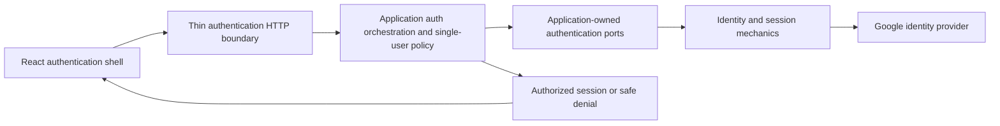
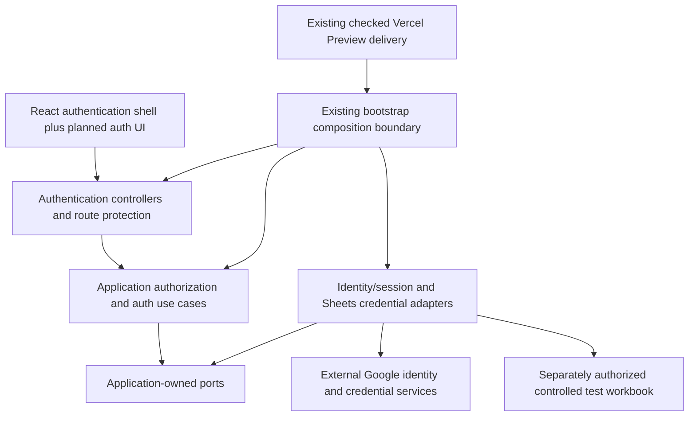

# Google login and private access — Architecture Overview

## 1. Pipeline / Integration
[ADR 003](../../adr/003-google-authentication-and-access.md) is Accepted after the user selected their Google account and seven-day database-free app sessions. Application policy, Google identity/crypto adapters, protected HTTP composition and frontend sign-in/logout are implemented and tested locally. The UI visual review passed in local Edge emulation at 320px/400px widths. The operator-only Sheets connection, verified credential/probe adapters and direct ignored-file setup are implemented locally; real owner verification, explicitly approved private credential storage, read-only refresh and the authorized isolated-workbook ID-only probe have passed. Hosted Preview configuration, checked delivery and anonymous/security checks have passed; the user completed exact Google callback registration and real owner browser sign-in/logout. Request history independently confirms session 200 and logout 204. All seven steps are complete and merged into main under the user's separate 2026-11-25 approval; product Production release is not included. No credentials or Google resources are provisioned by local tests.

| Stage | Responsibility | Location |
|---|---|---|
| Design | Resolve flow, lifecycle, storage, scopes, redirects and explicit public exceptions | Step 01; ADR 003 |
| Application | Own sign-in/session/logout policy and authorization by configured stable subject | apps/api/src/application; step 02 |
| Infrastructure | Verify Google identity and implement approved session mechanics | apps/api/src/infrastructure; step 03 |
| HTTP/composition | Map transport and wire concrete dependencies; protected routes by default | Existing API/bootstrap boundaries; step 04 |
| UI | Render session states and use a central backend API client | Existing apps/web/src; step 05 |
| Sheets credentials | Separate local owner/consent entrypoint, SDK refresh, inward owner policy and ID-only metadata probe | Step 06 implemented/tested locally and verified against the authorized isolated workbook; mapping remains feature 3 |
| Verification | Check negative paths, real Preview behavior and handoff evidence | Step 07; existing CI |

## 2. Component Diagram

Source dependencies point inward. Runtime external calls occur through application-owned ports. Controllers do not decide who may use the app; infrastructure verifies claims and performs I/O without allowed-user or expense policy. Delegated OAuth with a refresh credential in existing secure backend configuration is selected; no service account, federation or new credential database is introduced. The accepted seven-day fixed session has no per-session server-side revocation; logout clears the current browser cookie, and the documented global invalidation controls remain available. api/index.ts stays a thin host adapter.

## 3. Data Flow

### 3.1 Inbound / Ingestion
The browser uses the exact login/callback/session/logout contracts approved in step 01. Provider responses and cookies are untrusted inputs. Only the minimal health and explicitly approved login/callback routes may be public; there is no general authentication-route exemption.

### 3.2 Processing / Event Handling
Infrastructure exchanges/verifies identity and implements the selected session mechanics. Application authorizes the configured stable Google subject and owns accepted auth lifecycle policy through ports. API security mechanics enforce the approved request/callback/CSRF controls; controllers delegate decisions. Reject invalid, expired, replayed and wrong-user inputs with safe outcomes. Credential refresh and session expiry/revocation follow the accepted design; no stronger guarantee is inferred.

### 3.3 Query / Serving
The frontend checks the approved protected session contract and renders signed-out, loading, allowed, denied or error states. Backend checks remain authoritative. Logout follows the chosen server lifecycle, rather than merely hiding UI. Sheets access verification uses a separately authorized test workbook and no financial data; annual mapping and app reads/writes belong to later features.

## 4. Data Stores Summary
| Store or state | Technology/status | Purpose |
|---|---|---|
| Source and test fixtures | Existing Git repository; synthetic values only | Versioned feature and security evidence |
| Session/flow state | Separate purpose-bound encrypted HttpOnly cookies; fixed seven-day session and ten-minute flow | Accepted lifecycle, PKCE/state/nonce and CSRF binding; no database or individual copied-cookie revocation |
| Server credential configuration | Existing encrypted host settings/ignored local configuration; owner OAuth grant | Backend-only refresh credential and OAuth client secrets; never client storage |
| Controlled test workbook | Separately authorized isolated Google resource | Read-only access verification in step 06; no structure changes |
| Existing annual expense workbooks | Unchanged; not used as fixtures here | Future feature-3 mapping and feature-4 expense persistence |

No expense database, preference store, transaction history or financial cache is introduced. The single delegated refresh credential uses existing secure configuration; a token database is not authorized.

## 5. Extension Points
Later use cases reuse application authorization and receive external capabilities through inward ports. Feature 3 owns annual-workbook mapping and layout discovery; feature 4 owns supported formulas, write permissions and concurrency. Mobile preferences and PWA behavior remain separate. Vercel deployment credentials and its platform access gate are distinct from application login and Google Sheets credentials.

## 6. Security & Isolation
- Protected routes authenticate by default; application use cases enforce configured-subject authorization. Test-only routes can demonstrate the default without exposing a fake business endpoint.
- Accepted public exceptions are GET/HEAD health and exact GET login/callback. Local tests cover OIDC/PKCE/state/nonce, encrypted cookies, fixed lifetimes, CSRF, fixed redirects and logout semantics. Live provider/Preview verification remains separate.
- Explicitly plan local and stable Preview redirect origins and their Google configuration; do not infer wildcard redirects or treat Vercel sign-in as application authorization.
- The user selected delegated Google OAuth. Initial access is read-only and tested only with a controlled workbook; the OAuth scope itself is not a per-file boundary. Personal-mode audience, exact consent and credentials are configured only in a concrete approved setup. No trial, billing, service account or federation is needed for the selected approach.
- Keep tokens, private workbook identifiers and provider secrets out of client bundles, browser preference storage, logs, commits and error details. Do not request secrets in chat.
- Infrastructure performs verification/exchange/I/O mechanics, application owns access policy, and bootstrap loads validated configuration. No production workbook data or financial fixture is needed for authentication tests.
- Use meaningful TDD for every runtime/configuration behavior and the existing checks before Preview deployment. Product production rollout and expanded storage/dependencies require their own approval.
