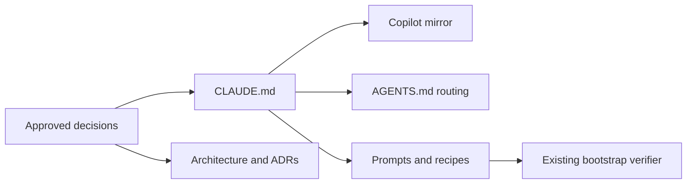

# Repository bootstrap architecture

## Pipeline / integration
Existing template → factual discovery → conversation-approved decisions → configured project documentation → structural verification → human review.

## Component diagram

All components are repository documents or existing tooling. No application runtime components are created.

## Data flow
Only approved project facts and workflow policy are written. No Google Sheets, financial records, credentials or cloud configuration are read or changed during bootstrap.

## Data stores
| Store | Change |
|---|---|
| Git working tree | Documentation and local AI rules only; no commit or push |
| Application data | None |

## Extension points
Future application foundation and implementation work require their own approved feature checklists. Toolchain and deployment configuration are deferred to those features.

## Security & isolation
No secrets or real spreadsheet identifiers are committed. Remove inherited unrelated Claude tool permissions; do not expand permissions. Preserve `.git` and unrelated user files.
