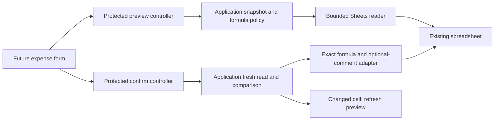

# Safe expense registration backend — Architecture Overview

## 1. Pipeline / Integration
Execution is requested. On 2026-11-26 the user replaced the proposed metadata-based mechanism with previewing the cell, deciding whether to add another expense and warning about possible duplicates. Past-date entries are explicitly required. The metadata/guard/receipt design and its pending approval question are superseded, not accepted. Local implementation, approved owner write consent and isolated synthetic writes/comments are verified; approved Preview setup, feature push and actual checked delivery are verified; the final real-browser save is pending a manual console safety-warning hand-off. The five-step order remains unchanged; the revised HTTP/port contracts and limitations are approved by the user on 2026-11-26 and recorded in Accepted ADR 007. Steps 01-04 are locally verified; step 05 has controlled Google evidence and has approved Preview setup, successful actual checked delivery and controlled hosted evidence; final real-browser save verification is pending.

| Step | Responsibility | Status |
|---|---|---|
| 01 | Formula/FX/comment rules, current-cell preview, past dates and advisory duplicate signals | Approved 2026-11-26; step 01 complete |
| 02 | Stateless preview comparison and protected contracts; explicit concurrency/uncertainty limits | Approved under ADR 007; step 02 complete; no durable coordination |
| 03 | Owner-approved write grant and isolated fixture configuration | Complete; separate local owner writer grant and exact isolated fixtures verified |
| 04 | TDD implementation in accepted layers | Complete locally; application, formula, adapters, protected transport and composition verified |
| 05 | Controlled and checked hosted verification, then handoff | Controlled local/hosted writes/comments and actual checked Preview passed; final real-browser save pending |

## 2. Component Diagram
| Component | Existing/new | Responsibility |
|---|---|---|
| React sign-in shell / future expense form | Existing / feature 5 | Later UI shows selected-cell data, confirmation and warnings; no UI code in this backend feature |
| Auth/session/CSRF | Existing | Default owner authentication, exact Origin/CSRF on POST requests |
| Preview/save/comment-only controllers | Implemented locally | HTTP shape, verified principal handoff, delegation and DTO/status projection |
| PreviewExpense / RegisterExpense / formula planner | Implemented application | Validation, owner/target/currency rules, parser, existing-data/duplicate warnings, expected-state comparison and outcomes |
| Mapping / raw reader / delegated credentials | Existing, approved extensions implemented | Explicit annual/monthly/storage-currency/rate context and bounded provider data |
| Exact formula/comment writer and fingerprint implementation | Implemented infrastructure | Mechanical Google I/O and deterministic hashing through inward ports; no business policy |
| Bootstrap / Node-Vercel adapter / CI | Existing, local wiring verified | Validated private configuration, portable factory and checked Preview |
| Spreadsheet and actual cell comments | Existing external service | Authoritative formulas, conversion, totals and optional text |

No metadata, guard, receipt ledger, database, queue, cache or new service is selected. No lock is implemented in memory. Application imports no SDK, Fastify, environment or infrastructure; controllers and infrastructure do not decide expense policy.

## 3. Data Flow
### 3.1 Inbound / Ingestion
Caller supplies a calendar date, decimal amount, category ID, currency and optional comment, never a workbook ID, cell address, FX value or formula. Past dates are valid for every configured year/month/day; there is no today-only rule, retired-month rule or cutoff introduced for cleanup. The user still creates/configures annual workbooks; an absent year/month fails explicitly rather than guessing or creating it.

### 3.2 Processing / Event Handling
1. Preview authorizes the owner and refreshed Google subject, resolves the selected target from configuration, reads its current expression/calculated value and verifies layout/rates. Read only the selected target and bounded structural/rate context; do not return monthly financial history.
2. Return whether the cell has existing data, its current total in the cell's storage currency, its actual formula or scalar content as plain text, and an advisory possible-duplicate signal. A blank cell has no existing-data warning. A populated zero is distinguished from a blank rather than discarded.
3. For a supported expression, construct the complete proposed new formula and a deterministic fingerprint of the normalized expense command, relevant mapping/layout/rates and raw existing-cell state. This fingerprint is an expected-state checksum, not a lock, authentication token, durable submission receipt or proof that a human viewed the UI. Session/CSRF still authorize the request.
4. Future feature 5 shows the existing content and total, explains existing-data/possible-duplicate warnings, and offers an explicit Add another expense decision. The form disables Save while a request is in flight and does not retry automatically. The backend requires acknowledgment of the warnings it actually returned for that preview.
5. Save independently validates/authorizes again and freshly reads/rechecks the target and relevant context immediately before constructing its exact write plan. Compare the fresh fingerprint with the expected state returned by preview. A mismatch gives cell_changed and a required new preview; do not add to a stale expression or silently overwrite a detected change.
6. When the snapshot still matches and acknowledgments are present, execute one complete formula mutation and optional anchored comment using minimal fields. Let Sheets perform conversion and totals. Report known expense success separately from comment success/failure/uncertainty.

**Approved step-01 formula/comment rules**
- Accept a positive decimal string, no sign/exponent/grouping separators, up to nine integer and six fractional digits, canonicalized without rounding. Reject zero, negative/refund inputs, NaN/Infinity and user-supplied formula text. The upper bound is 999999999.999999 and the smallest accepted positive precision is 0.000001. Google Sheets still calculates the formula; the backend only validates/serializes decimal text.
- First expense in a blank cell is =(5); append to a supported expression as =(5)+(6), then =(5)+(6)+(7). For a manually entered supported expression, remove only its leading equals and wrap its exact text once as one old block: =12+13+14*F4 becomes =(12+13+14*F4)+(5). If the old expression is already entirely one or more complete parenthesized terms separated by top-level plus signs, append directly and keep those terms flat; do not add an outer pair on every save. Preserve whitespace, quoted sheet names, references and arithmetic meaning, and generate one complete parenthesized new term. Do not flatten/reassociate old sums across multiplication, division or subtraction, normalize all old formulas, substitute cached amounts or repair syntax.
- Initially support existing scalar numbers and a bounded arithmetic grammar: decimal/scientific numeric literals, unary signs, +, -, *, /, parentheses and same-workbook A1 references with optional absolute markers and quoted/unquoted existing sheet names. No functions, ranges, names, external-workbook references, comparisons, strings, arrays or executable expressions. A nonempty text cell, provider error, malformed expression, unsupported construct, over 8,000 characters, over 2,048 tokens or over 32 nested groups rejects before mutation. Broader grammar is a future explicit change, not silent permissiveness. New submitted amounts do not accept exponent syntax even though legacy numeric literals can.
- Every new expense is its own term. For a KZT-stored synthetic category with AED configured at Q39/multiply: =(100*$Q$39)+(500)+(50*$Q$39). Division remains supported when a configured rate requires it; JPY was only a previous synthetic fixture, not a real-user currency requirement. Use absolute same-tab references and correctly quoted absolute cross-tab references from configuration. Changing the rate in Sheets changes dependent results; no historical-rate snapshot is added.
- Add explicit storageCurrency to category mapping schema version 2, required for write-enabled categories. Preserve version-1 read-context compatibility; v1 has no implicit permission to write. Storage currency must be one of the month's configured currencies. If input equals storage, add directly. Otherwise construct a term from input to workbook base using its configured direction, then from base to storage using the inverse of storage's configured direction. This supports native columns and cross-currency input without computing a numerical rate or guessing a new cross-rate. Validate every referenced rate and reject a target overlapping a configured rate/header/date cell.
- Comment is optional; missing or whitespace-only means no comment and no comment request. Normalize line endings/outer whitespace, reject control characters except line feed/tab, and cap user text at 1,500 UTF-8 bytes so the generated content fits Google's 2,048-unit limit. Add one new non-assigned comment thread per submitted expense, anchored to its exact cell; do not alter existing threads/replies/notes. Include the expense amount and currency with the supplied text for association; no internal submission UUID is needed in visible comments. No assignee or mention-generation behavior; Google's ordinary comment notifications follow the workbook's own settings.
- The response distinguishes expense saved/not saved/unknown from comment not requested/saved/failed/unknown. A comment-only failure does not undo the expense or authorize re-adding it. No expense or comment is automatically replayed after uncertainty. A separately confirmed comment-only action must never include a formula mutation. Without durable receipts, the backend does not claim it can verify a prior request outcome from a UUID or the absence/presence of a matching term.

**Existing data and possible duplicates**
- Existing data is information, not a ban on another entry. An intentional second expense with the same amount/currency remains allowed after explicit warning acknowledgment. Past dates use exactly the same flow as today.
- Compare the planned normalized expense term with supported existing top-level expense terms using the parser and configured currency references; do not treat every numeric literal as a purchase. A structurally matching amount/conversion term produces possible_duplicate, never already_saved or a guaranteed identity match.
- Legacy expressions can group several purchases under one FX multiplier or use references/subtraction. Where individual purchases cannot be reliably distinguished, return duplicate_check_inconclusive plus the actual existing expression for owner review. Absence of a warning is not proof the expense is new.
- Malformed/unsupported existing expressions are visible for review but remain non-writable; owner acknowledgment cannot bypass parser/layout/permission failures. No direct formula editing is accepted from the browser.

**Safety limits of the user-directed approach**
- A fresh read and fingerprint comparison detects changes since preview, but a different request/manual edit can still occur between the final read and Google commit. Two overlapping saves can overwrite one another. This is explicitly best-effort conflict detection; it provides neither cross-instance serialization nor exactly-once/idempotent submission.
- Future UI disables repeated taps, but this does not coordinate another device/tab or prevent a direct request. Advise one save at a time and avoid editing the same target/layout/rates during a save. Do not claim the backend enforces those habits globally.
- No automatic retry after a dispatched write times out, returns an ambiguous transport/5xx outcome or the process dies. Return outcome_unknown and require owner review of a fresh preview/Sheets before an explicit new decision. A matching new term is only a warning clue, not proof of which request committed.
- No request-status endpoint can recover a historical submission outcome without a durable store. No cleanup, retired dates, metadata receipts or busy-marker recovery is needed in this design. If strong concurrent-write protection later becomes a requirement, agree an additional mechanism then rather than claim the preview supplies it.

### 3.3 Query / Serving
The following HTTP/port contracts are approved for implementation; the local write endpoints are implemented; hosted verification is pending:
- POST /api/expenses/preview accepts date, amount, categoryId, currency and optional comment. It is authenticated and exact-Origin/CSRF protected despite being read-only externally. Return date/category, storageCurrency, currentCell {hasData, calculatedTotal, formula, scalarValue}, proposedFormula when valid, expectedVersion, canSave and fixed warnings. The owner explicitly requested this one-cell financial/formula preview; it is an intentional DTO exception to the catalog's minimal response, not permission to log financial data or expose history. Existing GET /api/expense-context remains minimal.
- POST /api/expenses accepts the same normalized command, expectedVersion and acknowledgment flags for existing_data/possible_duplicate/duplicate_check_inconclusive. Unknown keys, raw formula/address/rate parameters and invalid command states are rejected. Application recomputes the warning state and fingerprint from a fresh read; acknowledgments cannot bypass a mismatch or unsupported formula. Return 201 only for a confirmed write, fixed 409 for changed cell/required acknowledgment/unsupported existing content, 400 for invalid command, 503 for unavailable setup or definite pre-dispatch dependency failure, and 202 for an uncertain post-dispatch outcome. Authentication stays 401/403.
- Include a separate protected POST /api/expenses/comments for an explicitly owner-confirmed comment-only action using selected date/category, text/expense association and a fresh expectedVersion. Its plan can only create a comment; it never changes a formula or re-adds an expense. Without receipts it is a new comment request, not a verified idempotent retry of historical delivery. A prior unknown comment result requires explicit warning/review, not automatic resend. Its exact closed body will be verified by TDD with the other approved command bounds.
- Save DTO contains expense {saved|not_saved|unknown} (unchanged for a comment-only action) and comment {not_requested|saved|failed|unknown} plus fixed safe codes. A comment failure after a confirmed expense does not become expense failure, and the frontend must not repeat Save to recover only the comment. A fresh preview can help the owner investigate uncertainty but cannot prove a past request identity.
- Application owns the normalized command, preview snapshot, bounded parser/serializer, duplicate-warning policy, fresh-read comparison, acknowledgments, exact write plan and outcome policy. Proposed inward contracts cover bounded target/context reads, deterministic snapshot fingerprinting and execution of an exact formula/comment-only plan with safe provider outcomes. Infrastructure hashes/serializes/calls Google mechanically; it cannot choose cells/formulas, decide duplicates or retry writes. Bootstrap composes these contracts; no new service/store/dependency or confirmation secret is required.
- Retain the proposed explicit per-category storageCurrency in mapping schema version 2 and preserve v1 read-context behavior. Writes require verified storage-currency mappings. Private EXPENSE_WRITES_ENABLED defaults disabled; a separate GOOGLE_SHEETS_WRITE_REFRESH_TOKEN is proposed so the current read-only grant stays independent. Google owner/write consent and any cloud transfer remain separate concrete operational approval steps.
- Proposed checked Preview keeps the same stable alias/callback, with a tested branch-guard transition to feature/safe-expense-registration-backend only when approved for delivery. No automatic publication, credential upload, merge, product Production path or real workbook activation is included.
- All preview/write/comment responses are no-store/no-referrer. Return only the selected cell's intended owner-visible content, never configuration IDs/secrets or unrelated history; render formula/comment strings as plain text in the later UI. No amounts, formulas, comments, request bodies, tokens or credential-bearing query strings in diagnostics.

## 4. Data Stores Summary
| Store | Technology/status | Data | Purpose |
|---|---|---|---|
| Annual workbook | Existing Google Sheets | Existing expense cells, conversion and totals | Authoritative financial calculations and recorded expressions |
| Cell comments | Existing Sheets threads | Optional user text associated with the exact expense cell | Preserve existing threads/notes; add only requested new comment |
| Private configuration | Existing ignored local/Vercel settings | Verified annual/month/category/storage-currency/rate mapping and credentials | Explicit routing and owner-bound access |
| Request/preview state | Transient request and later browser memory | Selected-cell snapshot/expected-state checksum | Detect a stale preview, without durable retry promises |

No application metadata, receipts, locks, ledger, hidden sheet, database, queue, persisted financial snapshot or history service is added. Past dates are not retired to manage receipt capacity. Browser request state is not an offline submission queue or authoritative datastore.

## 5. Extension Points
Additional currencies use explicit verified rate-cell/direction settings; only user-selected real currencies enter the real configuration. Division is a generic rate-direction capability, not a requirement to enable JPY. Category storage currency avoids native-column double conversion. The user-created 2027 workbook and older configured workbooks are routed explicitly.

Feature 5 later implements the requested current-cell total/formula preview, past-date selection, existing-data confirmation, possible-duplicate warning, disabled in-flight Save and truthful expense/comment/unknown feedback. This backend feature supplies its contracts, with no React implementation. Mobile preferences and PWA/Production remain features 6-7. A future requirement for strict concurrent edits would need a new agreed design; do not introduce durable state under this user-directed simpler flow.

## 6. Security & Isolation
- Existing owner sessions, application authorization and exact Origin/CSRF checks apply to all POST endpoints. No public expense/preview/comment/setup exception. Authorize both requesting and refreshed Google subject and select targets from private mappings only.
- Ordinary request data, formulas, comments and Sheets replies are untrusted data. No eval, arbitrary client formulas/addresses or HTML execution. Bound amount/comment/parser/provider payloads and reject unsupported states before writes.
- Preview explicitly reveals the selected cell's formula and calculated value to the authorized owner as requested. Existing catalog stays minimal and generic diagnostics exclude those financial contents. No direct Sheets/token access from frontend.
- Keep current read-only access until explicit write consent. Use the minimum approved Sheets write scope, not Drive-wide access or new billing, and verify real cell-comment support on isolated data. API scopes are account-wide capabilities, not cell-level security; target restriction is application policy.
- The real workbook is never a test write target. Exact fixture changes, consent, secret upload and publication require concrete authorization. Preserve original test cells and all unrelated formulas, totals, format, notes and comments. No formula/total repair or sheet restructuring.
- Provider comment saves can fail separately from cells. Inspect commentUpdateState and report uncertainty honestly; never reapply an expense for comment recovery. No automatic write retry or identity proof from formula matching/read-back.
- Fingerprints are optimistic comparisons, not locks or authenticated proof of human confirmation. No distributed isolation or exactly-once claim is made. The remaining final-read/commit race must be visible in the design and operator handoff.
- Mandatory behavior TDD and five-step order remain. Steps 01-02 are complete; later steps remain unchecked until actual acceptance criteria pass. See ADR 007 and checklist evidence for implementation progress.

Primary references: [Sheets batch atomicity and collaborator limits](https://developers.google.com/workspace/sheets/api/reference/rest/v4/spreadsheets/batchUpdate), [native comments and partial save](https://developers.google.com/workspace/sheets/api/guides/comments), [cell values and notes](https://developers.google.com/workspace/sheets/api/reference/rest/v4/spreadsheets/cells).
