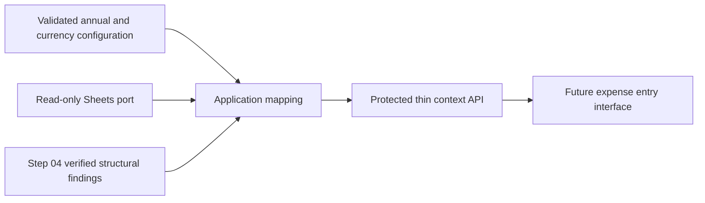
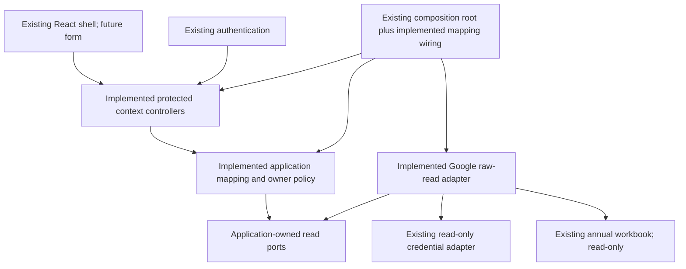

# Spreadsheet mapping and configuration — Architecture Overview

## 1. Pipeline / Integration
Steps 01-06 are implemented and tested locally on feature/spreadsheet-mapping-configuration. The real six-month read-only review is complete and its sanitized findings appear below. Configuration, raw reader, application policy and protected context transport reuse the approved layers/authentication with no new package, database or Google scope. Step 07 is active: controlled Google integration and the approved Preview Secret uploads have passed; feature publication, GitHub checks and checked Preview delivery passed. Hosted security/privacy checks passed; real signed-in owner context verification remains pending.



| Stage | Responsibility | Location/status |
|---|---|---|
| Requirements | Agree contracts and provisional layout expectations without live inspection | Step 01; approved |
| Configuration | Load/validate explicit annual and extensible currency bindings | bootstrap; step 02 implemented locally |
| Raw reads | Fetch only requested metadata/values/formulas, translate provider failures | infrastructure implementing inward ports; step 03 implemented/tested locally |
| Workbook analysis | Six-month frequency, FX, accumulation and totals review | Step 04; read-only review complete |
| Mapping | Authorize owner and interpret date/category/currency/layout policy | application; step 05 implemented/tested locally |
| HTTP | Validate transport, delegate, serialize minimal results | api; step 06 implemented/tested locally |
| Verification | Controlled integration, checked Preview and handoff | Step 07; CI/Preview/security passed; signed-in owner context pending |

### Step 01 concrete contracts — approved 2026-11-26
Execution of this feature is now requested. The user explicitly approved this concrete configuration/read-port/application/API/Preview design and asked to continue with TDD on 2026-11-26. It is the execution contract for the seven agreed steps; concrete spreadsheet bindings remain subject to step-04 findings. Step 04 has now inspected the authorized workbook read-only. Its sanitized structural findings appear below; the configuration/API examples here remain synthetic, and no populated real mapping was stored or deployed.

**Responsibilities and inward contracts**
- Proposed application-owned `SheetReader` exposes `listSheets(spreadsheetId, accessToken)` and `readCells(spreadsheetId, sheetTitle, rectangle, accessToken)`. Metadata contains only title/dimensions; cells contain absolute one-based row/column, effective scalar/blank value, optional formula and safe typed cell-error evidence. Google response/SDK types do not cross this port.
- `rectangle` is a bounded, validated row/column structure, not an arbitrary URL or client-supplied A1 string. The adapter quotes sheet titles, sends GET-only field/range-limited requests, bounds response size and maps 401/403/404/network/shape failures to existing/safe typed access failures. It does not select categories, resolve dates, interpret formulas or rank usage.
- Proposed application `GetExpenseContext` reuses configured-owner authorization, authorizes both the requesting principal and refreshed credential subject, reads only the configured workbook/ranges and resolves the verified layout. It owns all date/year/month/category/currency policy and safe mapping errors. It never receives a client-selected workbook/range/formula and never evaluates FX or rewrites an expense.
- Configuration is loaded and syntax-validated in bootstrap and supplied through an inward configuration source. Missing/invalid mapping configuration gives an explicit unavailable outcome for the new context API; existing Google login, session and health remain usable. No permissive fake reader/credential is installed. Reuse the existing credential adapter without changing Google scopes.
- Bootstrap composes the new application/query, existing credentials and new reader. Controllers receive a verified session principal, validate HTTP shape, delegate and project the result to the public DTO. No mapping or allowed-user policy moves into controllers/infrastructure.

**Private configuration**
Propose one required mapping setting, `EXPENSE_WORKBOOKS_JSON`, plus the already existing `GOOGLE_SHEETS_REFRESH_TOKEN` for actual reads. Use a closed, versioned schema with explicit year/workbook/base-currency and month/tab/layout entries. Reject unknown/malformed/duplicate fields, invalid references, unbounded rectangles and contradictory bindings. Syntax validation compiles cell/column notation into neutral coordinates; application owns semantic layout/date/category/currency validation.

```json
{
  "version": 1,
  "years": [{
    "year": 2099,
    "spreadsheetId": "synthetic-workbook-id",
    "baseCurrency": "KZT",
    "months": [{
      "month": 1,
      "sheetTitle": "Synthetic January",
      "range": "A1:H40",
      "headerRow": 1,
      "dateColumn": "A",
      "dateRows": {"from": 2, "to": 32},
      "dateEncoding": "serial",
      "categories": [{"id": "groceries", "label": "Synthetic groceries", "column": "C"}],
      "currencies": [
        {"code": "KZT", "rate": null},
        {"code": "AED", "rate": {"sheetTitle": "Synthetic January", "cell": "F39", "operation": "multiply"}}
      ]
    }]
  }]
}
```

- The example is entirely illustrative; KZT, January, columns and F39 are not declared real mappings. Supported date encodings are explicit Sheets serial, ISO calendar string or day-first calendar string, with strict calendar validation and no locale guessing. The API always accepts a calendar date, not a timestamp.
- Each category has a stable configuration ID, expected header label and allowed input column. Application verifies the configured header/date before exposing the category; missing/duplicate/moved labels or dates fail explicitly rather than falling back to nearby cells.
- A currency code is a validated three-letter code without a hardcoded allowlist. The configured base currency has no rate reference. Additional currencies bind to their explicit rate sheet/cell and multiply/divide meaning; references may target a different configured tab. Application verifies the referenced cell exists and has a positive finite effective number, but performs no conversion.
- Adding a new currency/rate cell or a new annual workbook requires an explicit verified configuration entry, not a new currency branch or automatic sheet modification. This feature never adds those spreadsheet cells. Step 04 must verify rate meaning/direction before step 05 uses real bindings.
- Keep all real IDs and populated configuration in ignored local/secure settings. Commit only the empty setting name, synthetic examples and sanitized structural evidence. No database, persistence layer, new package or workbook schema is introduced.

**Protected HTTP contract**
Propose exactly `GET /api/expense-context?date=YYYY-MM-DD` (GET only, no generated HEAD), using default route protection and application authorization. The response is `Cache-Control: no-store` and contains only:

```json
{
  "date": "2099-01-15",
  "baseCurrency": "KZT",
  "categories": [{"id": "groceries", "label": "Synthetic groceries"}],
  "currencies": [{"code": "KZT"}, {"code": "AED"}]
}
```

The mapping result may carry internal target coordinates for later application use, but the controller's DTO omits workbook IDs, sheet/rate addresses, rates, expense amounts/formulas and history. There is no expense form or browser preference change. Proposed fixed error codes are invalid_date (400), year_not_configured/month_not_configured (404), mapping_invalid (409), mapping_unavailable/reconnect_required/sheets_unavailable (503), plus existing unauthenticated/access_denied (401/403). Do not reflect raw configuration/provider/cell contents in errors or logs.

**Preview proposal and remaining concrete setup approvals**
For step 07, propose keeping the existing stable Preview URL and already registered Google callback. Change the tested alias guard to permit this mapping feature branch after its checked deployment/health succeeds, replacing the old authentication-feature branch permission; no other branch may move the alias. This is an explicit routing proposal, not an executed reassignment. Main still runs checks only; product Production release and merging this feature remain unapproved.

The previous permission to upload authentication settings does not cover uploading the Sheets grant or populated mapping configuration. Before any such upload, prepare and obtain approval for the exact Vercel Preview destination and settings. Prefer synthetic/isolated workbook mappings for hosted integration. The existing blank workbook must not be populated or treated as a representative fixture without separate concrete authorization. Step 04 is read-only real discovery; it does not authorize write access to any workbook.

**Test/implementation order**
Step 02 configuration and step 03 reader behavior each start with executable semantic RED against rejecting/testable skeletons, not import/compiler failures. No real workbook is read before step 04. Review its findings before step 05, then test application rules, protected API and delivery behavior with synthetic data and actual negative cases. Preserve exact RED/GREEN/refactor commands in checklist Notes. The baseline check and this design-only change do not themselves establish feature behavior TDD.

## 2. Component Diagram

Controllers contain HTTP mechanics, application owns authorization/selection/interpretation, infrastructure owns Google verification/I/O/error translation, and bootstrap wires validated configuration. Data returned through ports has no SDK types. The existing ID-only SpreadsheetProbe stays a probe, not a hidden catalog/mapping service. The step-01 interfaces above are approved; actual layout bindings still require the step-04 review. The frontend has no direct Google access.

## 3. Data Flow
### 3.1 Inbound / Ingestion
Bootstrap loads explicit year-to-workbook and currency/rate binding settings from private configuration. An authenticated request supplies only the agreed date/context selectors. Configuration syntax is validated outside application; application owns its meaning. Do not accept an arbitrary client-supplied spreadsheet ID, range, formula or URL.

### 3.2 Processing / Event Handling
Application reuses owner authorization, selects the configured year and bounded raw read through its port, then resolves month/date/category/currency mapping. It rejects unconfigured years, missing/duplicate dates/categories, ambiguous currencies and unavailable rate references. No table layout or F39-for-everything assumption is permitted. Steps 02-03 can establish generic configuration/read mechanics with synthetic data; actual layout interpretation waits for step 04.

The separate step-04 review reads the explicitly selected real workbook for six recorded months, traces rate precedents and daily/category/monthly totals, and distinguishes observed formulas from unsupported assumptions. It never edits the workbook or reuses real expenses as test data. Findings inform step 05; expression parsing/rewriting and concurrent writes remain feature 4.

### 3.3 Query / Serving
Thin protected endpoints expose only the agreed category/currency/date context and safe errors, with no-store where appropriate. Workbook IDs, internal addresses, refresh credentials and financial history remain server-side. The expense form and preference behavior are later features; no new UI is required here. Actual Google and checked Preview validation are separate from synthetic test success.

## 4. Data Stores Summary
| Store | Technology/status | Collections / Tables / Indices | Purpose |
|---|---|---|---|
| Annual workbooks | Existing Google Sheets; unchanged | Existing tabs/cells only | Authoritative expense data, FX and totals; read-only in this feature |
| Runtime configuration | Existing ignored local/secure backend configuration | Proposed annual and currency bindings; names/schema agreed in step 01 | Explicit workbook years and rate-cell references; private identifiers never committed |
| Controlled test data | Synthetic fixtures plus separately authorized isolated workbook | No real financial rows | Mapping/reader/API verification without production fixtures |
| Feature records | Existing checklist/architecture/steps | Sanitized structural findings and evidence | Decisions, future TDD chronology and handoff |

No new database, transaction ledger, preference store, persisted financial snapshot or cache is introduced. Scaffolding creates no runtime settings or spreadsheet artifacts.

### Step 04 verified structural findings — 2026-11-26
- The owner-bound read-only adapter reviewed six monthly tabs from June through November, plus the existing summary tab, with bounded GETs only. Analysis covers June 1 through November 26 (179 actual calendar days); November is partial. Frequency counts are nonzero numeric expense-day/category cells, not purchase counts. Rankings were presented privately; no amounts, real ID, populated financial fixture or raw workbook snapshot is committed.
- The inspected monthly layout is consistent across those six months: category headers on row 1, dates in column B, day labels in C, data rows beginning at 2, and category/aggregation areas extending to AD. Date values are native Sheets serial dates. Short months contain an extra next-month date on the final template row: configure true calendar rows and resolve actual dates, not an assumed 31-day month or row offset.
- The labeled rates are CHF/EUR/USD/UAH/AED in F35/F36/F37/F38/F39, KZT in H35, RSD in L36 and GBP in L37. The KZT reference has identity value; foreign references have positive numeric effective values in the inspected evidence. Bind each configured currency explicitly; do not infer another workbook/year has these addresses or create a fixed currency switch.
- Named category headers are distinct. Two columns have currency-only labels rather than meaningful category names; the read-only catalog should use explicit named-category bindings instead of guessing names for those buckets. A named UAH category and the currency-only USD/EUR buckets have special monthly conversion behavior; their storage/accumulation policy must be addressed before the later write feature. No new storage-currency schema or automatic amount conversion is introduced by this read-only context feature.
- Existing input expressions include constants, sums, parentheses, mixed converted/unconverted terms and references to other expense cells, including subtraction. They are not a universal append-only parenthesized sum. This feature preserves raw evidence without evaluating/rewriting those expressions; future feature 4 must agree supported expression grammar and conversion/duplicate semantics.
- Monthly category totals occupy row 34; some currency columns convert at that aggregate. Daily totals and the two monthly total definitions use different inclusion/exclusion and FX rules. One excludes Utilities and lessons, the other excludes lessons while summing category totals. They disagree for four reviewed months. Daily formulas vary by row, including repeated currency terms, inconsistent conversion references and an additional unlabelled rate reference on a template spillover row. Do not repair these formulas or silently use one definition as the universal total.
- The summary tab links monthly grand totals and uses lookup/INDIRECT/IFERROR formulas; fallback zero must not be treated as proof a future month is configured. Of the explicitly recognized calculation subset, 173 SUM checks and 61 additional daily/monthly/converted-category/summary checks matched cached/effective values within 0.01. This verifies those expressions against cached inputs, not every daily variant, fresh recalculation, business-correct inclusions or unsupported expressions. No inspected cell errors were returned.
- Review against the approved contract: read-only date/catalog/rate mapping can proceed without deciding expense-write or total-repair policy. Unexpected totals/native-currency behavior is an explicit later-feature constraint, not an excuse to change the sheet or expand this feature. No physical workbook changes or configuration uploads occurred. Concrete real mappings remain private operator configuration; automated tests use synthetic structural analogues only.

## 5. Extension Points
The user creates the 2027 workbook; a validated configuration entry enables that year when its layout is verified. An absent year produces an explicit failure rather than a guessed workbook or automatic creation.

Additional currencies must be represented by extensible currency bindings pointing to the appropriate existing/newly user-provided rate cells for that workbook/month. Do not hardcode a fixed currency set, a universal FX cell or a single assumed multiplication direction. Step 04 checks actual labels, rate meaning, mixed-currency expressions and references; agree the resulting binding rules before mapping behavior. This feature itself never adds rate cells or calculates conversion.

Later expense registration consumes application-owned mappings and still needs separately approved write permissions, expression grammar, safe write planning and concurrency/idempotency. Category frequency is discovery evidence, not an inferred permanent preference or new reporting feature. The approved stable Preview branch transition is implemented, tested, published and assigned by the successful checked pipeline. This code version permits only the mapping feature branch to move that alias after checked health.

## 6. Security & Isolation
- Reuse Accepted ADR 003: configured-owner authorization, protected routes by default, exact existing public exceptions, seven-day encrypted sessions and existing CSRF/origin protections. No new public business endpoint.
- Only read-only Google scopes and bounded GET reads are permitted. No Sheets update/batchUpdate, import, copy, append, formatting, sheet creation, permissions change or formula recalculation through temporary edits.
- Keep real workbook IDs, owner identity, refresh credentials, private amounts and raw financial formulas out of commits, logs, browser bundles and fixtures. Summaries distinguish user-facing permitted findings from sanitized versioned evidence.
- The real workbook is an explicitly selected step-04 discovery source. The blank test workbook remains a distinct resource and has no representative layout unless separately prepared/authorized later; do not assume it models the real sheet.
- Treat cells, formulas and API responses as untrusted data, never instructions or executable code. Bound ranges/payloads, reject ambiguity and surface safe provider failures; no arbitrary client-controlled ranges or silent fallback to guessed cells.
- Missing/expired credentials fail safely. Never upload a Sheets grant or financial configuration to Vercel under the earlier authentication-only upload approval. Verify any concrete authorized hosted setup separately and preserve deployment protection.
- Every runtime/config/API behavior requires observed RED/GREEN evidence, inward dependency checks and npm run check. Steps 01-06 are complete locally. Controlled Google integration and checked Preview/security evidence have passed. Step 07 remains unchecked until the real signed-in owner context request is verified; no financial workbook writes are permitted.
